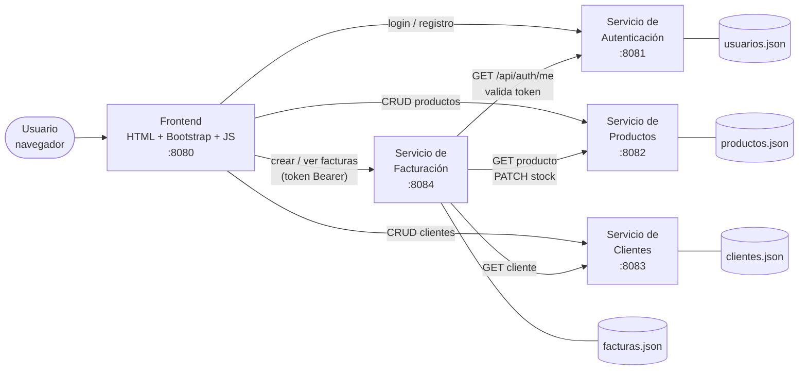
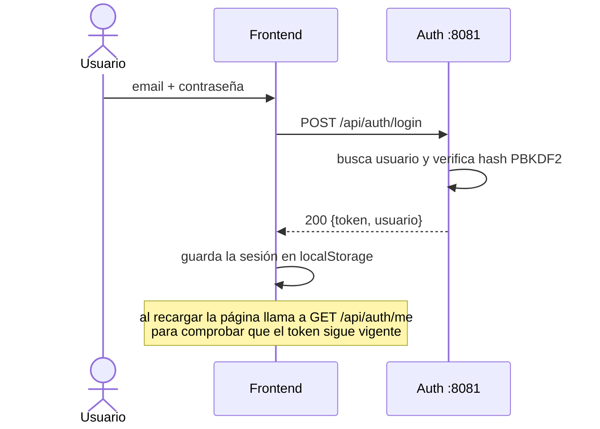
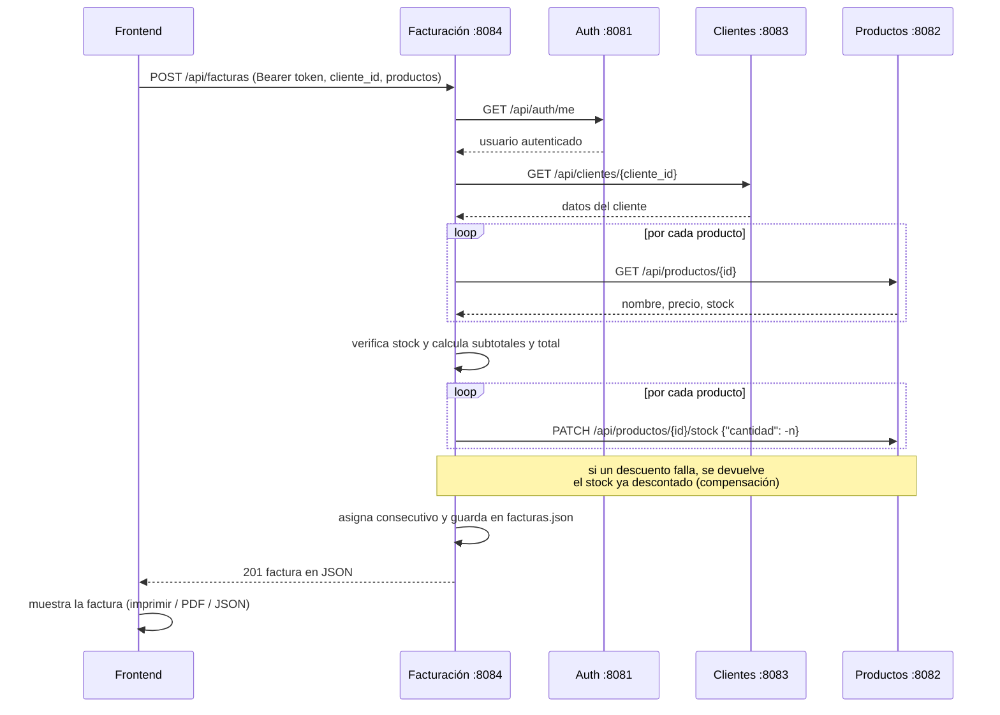

# Documento técnico — Sistema de Facturación Digital

Programación Avanzada 2026-2 · Proyecto 1

## 1. Descripción general

El sistema permite a un usuario autenticado registrar clientes, gestionar productos
(precio y stock) y generar facturas de venta. Está construido como un conjunto de
**microservicios independientes en Go** que se comunican mediante **REST/JSON** sobre
`net/http`, y un **frontend en JavaScript** (Bootstrap 5 + JS puro).

Cada microservicio es dueño de sus datos: lee y escribe su propio archivo JSON y ningún
otro servicio accede a ese archivo directamente; si necesita esos datos, llama a su API.

## 2. Arquitectura



Versión en texto del mismo diagrama:

```
                       Navegador
                           │
                ┌──────────▼──────────┐
                │ Frontend JS  :8080  │
                └──┬──────┬──────┬────┘
        REST/JSON  │      │      │      (token Bearer)
     ┌─────────────┘      │      └──────────────────┐
     ▼                    ▼                         ▼
┌──────────┐  ┌──────────────────────┐   ┌────────────────────┐
│Auth :8081│  │Productos :8082       │   │Facturación :8084   │
│          │  │Clientes  :8083       │   │                    │
└────┬─────┘  └──────────┬───────────┘   └─────────┬──────────┘
     ▲                   ▲                         │
     │                   └──── GET cliente/producto, PATCH stock
     └──────────────────────── GET /api/auth/me ───┘

Datos: usuarios.json · productos.json · clientes.json · facturas.json
       (cada servicio lee y escribe solo el suyo)
```

### Estructura del código

```
FacturacionGo/
├── common/        Código compartido: JSONStore genérico, helpers HTTP, CORS, logs
├── auth/          main.go (handlers), security.go (PBKDF2 + JWT), data/usuarios.json
├── productos/     main.go, data/productos.json
├── clientes/      main.go, data/clientes.json
├── facturas/      main.go (handlers), servicios.go (cliente REST), pdf.go, data/facturas.json
├── frontend/      main.go (servidor estático), public/ (index.html, app.js, styles.css)
├── docs/          este documento y facturas de ejemplo
├── go.work        workspace de Go con todos los módulos
└── iniciar.bat    arranca todo en Windows
```

Cada servicio es un **módulo Go independiente** (tiene su propio `go.mod`) y se
compila y ejecuta por separado.

### Decisiones de diseño

- **Persistencia en JSON** (`common/store.go`): `JSONStore[T]` es un tipo genérico que
  carga el archivo al iniciar, guarda los registros en memoria y los vuelve a escribir en
  cada cambio. Usa un `sync.RWMutex` para que las peticiones concurrentes no corrompan los
  datos, y escribe primero en un archivo temporal que luego renombra (escritura atómica).
- **Contraseñas**: se guardan con PBKDF2-SHA256 (100.000 iteraciones, sal aleatoria de 16
  bytes), nunca en texto plano. Formato: `pbkdf2-sha256$iteraciones$sal$hash`.
- **Tokens**: el servicio de autenticación emite un JWT firmado con HMAC-SHA256 que dura
  8 horas. El frontend lo envía en `Authorization: Bearer <token>`.
- **Validación centralizada del token**: el servicio de facturación no conoce el secreto
  del JWT; para cada petición llama a `GET /api/auth/me` y el servicio de autenticación le
  responde con el usuario o con 401.
- **Consistencia del stock**: el descuento de stock (`PATCH /stock`) comprueba y descuenta
  en una sola operación bajo el mutex del servicio de productos, así dos facturas
  simultáneas no pueden vender la misma unidad. Si falla un descuento a mitad de la
  factura, facturación devuelve el stock ya descontado (compensación).
- **CORS**: como el frontend (puerto 8080) y los servicios corren en puertos distintos,
  todos los servicios responden las cabeceras CORS y las peticiones `OPTIONS`.
- **Errores**: todas las respuestas de error tienen la forma `{"error": "mensaje"}`.

## 3. Endpoints

### 3.1 Servicio de Autenticación — `http://localhost:8081`

| Método | Ruta                  | Descripción                                   | Respuestas |
|--------|-----------------------|-----------------------------------------------|------------|
| POST   | `/api/auth/register`  | Registra un usuario y devuelve token          | 201, 400, 409 |
| POST   | `/api/auth/login`     | Inicia sesión y devuelve token                | 200, 401 |
| GET    | `/api/auth/me`        | Valida el token y devuelve el usuario         | 200, 401 |
| GET    | `/api/auth/usuarios`  | Lista usuarios (sin contraseñas)              | 200 |
| GET    | `/health`             | Estado del servicio                           | 200 |

Registro:

```http
POST /api/auth/register
Content-Type: application/json

{ "nombre": "Laura Díaz", "email": "laura@example.com", "password": "secreta1", "rol": "vendedor" }
```

Respuesta de login o registro:

```json
{
  "token": "eyJhbGciOiJIUzI1NiIsInR5cCI6IkpXVCJ9.eyJzdWIiOjEsIm5vbWJyZSI6...",
  "usuario": { "id": 1, "nombre": "Ricardo Gómez", "email": "ricardo@example.com", "rol": "admin" }
}
```

Validaciones: nombre obligatorio, email válido y único, contraseña de al menos 6
caracteres, rol `vendedor` o `cliente` (el rol `admin` solo se asigna en el archivo).

### 3.2 Servicio de Productos — `http://localhost:8082`

| Método | Ruta                          | Descripción                                   | Respuestas |
|--------|-------------------------------|-----------------------------------------------|------------|
| GET    | `/api/productos?q=texto`      | Lista productos (filtro opcional por nombre)  | 200 |
| GET    | `/api/productos/{id}`         | Obtiene un producto                           | 200, 404 |
| POST   | `/api/productos`              | Crea un producto                              | 201, 400 |
| PUT    | `/api/productos/{id}`         | Actualiza nombre, precio y stock              | 200, 400, 404 |
| DELETE | `/api/productos/{id}`         | Elimina un producto                           | 204, 404 |
| PATCH  | `/api/productos/{id}/precio`  | Cambia solo el precio `{"precio": 95000}`     | 200, 400, 404 |
| PATCH  | `/api/productos/{id}/stock`   | Ajusta el stock `{"cantidad": -2}` (suma o resta) | 200, 404, 409 |

Cuerpo de creación/actualización: `{"nombre": "Teclado", "precio": 150000, "stock": 10}`.
Reglas: nombre obligatorio, precio > 0, stock ≥ 0. El ajuste de stock responde **409** si
el resultado quedaría negativo.

### 3.3 Servicio de Clientes — `http://localhost:8083`

| Método | Ruta                     | Descripción                                        | Respuestas |
|--------|--------------------------|----------------------------------------------------|------------|
| GET    | `/api/clientes?q=texto`  | Lista clientes (busca por nombre, cédula o email)  | 200 |
| GET    | `/api/clientes/{id}`     | Obtiene un cliente                                 | 200, 404 |
| POST   | `/api/clientes`          | Registra un cliente                                | 201, 400, 409 |
| PUT    | `/api/clientes/{id}`     | Actualiza un cliente                               | 200, 400, 404, 409 |
| DELETE | `/api/clientes/{id}`     | Elimina un cliente                                 | 204, 404 |

Cuerpo: `{"nombre": "Carlos Pérez", "cc": "1234567", "email": "carlos@example.com", "direccion": "Calle 123 #45-67, Bogotá"}`.
Reglas: todos los campos obligatorios, cédula solo numérica y única (409 si se repite),
email válido.

### 3.4 Servicio de Facturación — `http://localhost:8084`

Todas las rutas exigen `Authorization: Bearer <token>`.

| Método | Ruta                          | Descripción                                 | Respuestas |
|--------|-------------------------------|---------------------------------------------|------------|
| POST   | `/api/facturas`               | Genera una factura                          | 201, 400, 401, 409, 502 |
| GET    | `/api/facturas?cliente_id=`   | Lista facturas (más recientes primero)      | 200, 401 |
| GET    | `/api/facturas/{id}`          | Obtiene una factura en JSON                 | 200, 401, 404 |
| GET    | `/api/facturas/{id}/pdf`      | Descarga la factura en PDF                  | 200, 401, 404 |

Petición para generar una factura:

```http
POST /api/facturas
Authorization: Bearer eyJhbGciOi...
Content-Type: application/json

{
  "cliente_id": 201,
  "productos": [
    { "id": 101, "cantidad": 1 },
    { "id": 102, "cantidad": 2 }
  ]
}
```

Códigos de error: **400** si el cliente o un producto no existe o una cantidad es inválida;
**401** si el token falta o no es válido; **409** si no hay stock suficiente; **502** si
alguno de los otros servicios no responde.

## 4. Flujos

### 4.1 Autenticación



### 4.2 Generación de una factura



Pasos del servicio de facturación:

1. Valida el token con el servicio de autenticación → obtiene el **usuario**.
2. Consulta el **cliente** en el servicio de clientes.
3. Agrupa productos repetidos, consulta cada **producto** y verifica que haya stock.
4. Calcula `subtotal = precio_unitario × cantidad` y el `total`.
5. Descuenta el stock en el servicio de productos.
6. Asigna el siguiente número de factura (desde 5001), guarda la fecha y persiste en
   `facturas.json`.

### 4.3 Uso del frontend

1. **Ingresar** o **Registrarse**.
2. **Productos**: crear, editar, eliminar, buscar; botón 🛒 para agregar a la factura.
3. **Clientes**: registrar, editar, eliminar, buscar.
4. **Nueva factura**: elegir el cliente (o registrar uno nuevo), agregar productos y
   cantidades, y pulsar **Generar factura**.
5. Se abre la factura con las opciones **Imprimir / Guardar PDF** (diálogo del navegador),
   **Descargar PDF** (generado por el servidor), **Ver JSON** y **Descargar JSON**.
6. **Facturas**: historial de facturas generadas; cada una se puede volver a abrir.

## 5. Ejemplo de factura generada

JSON devuelto por `POST /api/facturas` (también en [ejemplo-factura.json](ejemplo-factura.json)):

```json
{
  "factura_id": 5004,
  "cliente": {
    "id": 201,
    "nombre": "Carlos Pérez",
    "cc": "1234567",
    "email": "carlos@example.com",
    "direccion": "Calle 123 #45-67, Bogotá"
  },
  "usuario": {
    "id": 1,
    "nombre": "Ricardo Gómez",
    "rol": "admin"
  },
  "productos": [
    {
      "id": 101,
      "nombre": "Laptop Lenovo ThinkPad",
      "cantidad": 1,
      "precio_unitario": 3500000,
      "subtotal": 3500000
    },
    {
      "id": 102,
      "nombre": "Mouse inalámbrico Logitech",
      "cantidad": 1,
      "precio_unitario": 12000,
      "subtotal": 12000
    }
  ],
  "total": 3512000,
  "fecha": "2026-10-28"
}
```

La versión en PDF de esta misma factura está en [ejemplo-factura.pdf](ejemplo-factura.pdf).
El PDF lo genera el propio servicio de facturación (`facturas/pdf.go`) sin librerías
externas: escribe directamente los objetos del formato PDF (catálogo, páginas, fuentes
Helvetica y el contenido de cada página).

## 6. Pruebas rápidas con curl

```bash
TOKEN=$(curl -s -X POST localhost:8081/api/auth/login -H "Content-Type: application/json" -d '{"email":"ricardo@example.com","password":"admin123"}' | sed -E 's/.*"token":"([^"]+)".*/\1/')
```

```bash
curl -s -X POST localhost:8084/api/facturas -H "Authorization: Bearer $TOKEN" -H "Content-Type: application/json" -d '{"cliente_id":201,"productos":[{"id":101,"cantidad":1}]}'
```

```bash
curl -s localhost:8084/api/facturas/5001/pdf -H "Authorization: Bearer $TOKEN" -o factura.pdf
```
